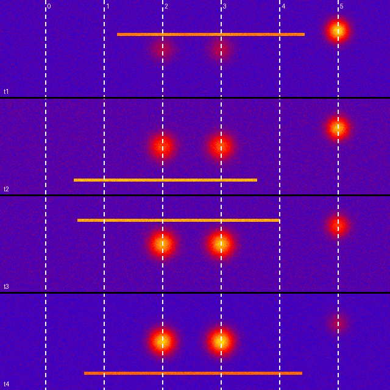
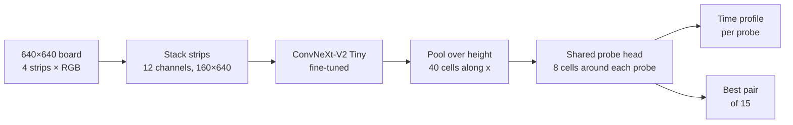

# Thermal Probe Forecasting for Metal 3D Printing

During laser powder-bed fusion, an infrared camera trails the laser. Given four thermal frames of a
build area, this model **forecasts how strongly each of six candidate probe positions will respond
at three future times**, then **picks the two positions worth spending a limited second-camera
budget on**.

The tricky part is telling real, growing hot spots from the things that look like them: a
transient spot that is bright now but fading, and the long bright traces the laser leaves as it
passes.

<p align="center">
  
</p>

*Synthetic example from [`make_toy_data.py`](make_toy_data.py): four strips in time order (t1 to
t4), with the six probe positions dashed. The spots at probes 2 and 3 grow; the one at probe 5 is
brightest early but fades, so it is a decoy. The horizontal lines are laser traces. Target:
levels `[[0,0,2,2,0,0],[0,0,3,3,0,0],[0,0,4,4,0,0]]`, best pair `2>3`.*

**Result:** a held-out score of **0.720** over 2,500 training boards (5-fold), and **0.696** on
a harder check where other boards' laser traces are laid over the held-out boards, simulating
recordings from unseen acquisition runs.

## How it works



- **Strips become channels.** The four time steps are stacked as 12 input channels, so the same
  sensor column lines up across time and the first convolution already sees how each spot
  changes.
- **The geometry is built into the head.** The feature map is pooled over height only, leaving 40
  cells along x. Probes sit exactly six cells apart, so **one head with shared weights** reads the
  eight cells around each probe plus a summary of the whole board. Every probe trains the same
  head, which multiplies the data it learns from by six.
- **Predict whole profiles, not single cells.** For each probe, the model picks one of the
  three-step time profiles that occur in the training labels. An ordinal side loss ("is the level
  above 0, 1, 2, 3?") adds a second view of the same target.
- **Label-preserving augmentation.** A left-right mirror (with labels mirrored), a shift by one
  probe spacing when both edge probes are empty, and vertical flips and rolls within each strip.
- **Laser-trace overlay.** To generalise to recordings from other runs, each training board gets
  the laser traces of another board from the batch laid over it. Half the time the brighter pixel
  wins; half the time the two intensities are summed and redrawn with a colour map learned from
  the training pixels. This was the single biggest gain on the harder check.
- **Ensemble and test-time views.** Five fold models and two full-data models are averaged, each
  over four views of the board (as is, mirrored, upside down, both).

## Results

Held-out scores on 5 folds of the 2,500 training boards. "+ traces" lays other boards' laser
traces over the held-out boards, a harder check closer to unseen acquisition runs.

| Model | Held-out | + traces |
| --- | --- | --- |
| ConvNeXt-Tiny, one head over the whole board *(fold 0)* | 0.541 | — |
| + shared per-probe head *(fold 0)* | 0.638 | — |
| + mirror augmentation *(fold 0)* | 0.674 | — |
| + shifts, flips, ordinal loss, 5-model ensemble | 0.702 | about 0.65 |
| + laser-trace overlay, vertical roll | 0.704 | 0.689 |
| **+ ConvNeXt-V2 Tiny backbone, mixed overlay (final)** | **0.720** | **0.696** |

Tried and dropped: a per-strip encoder, a physics-style response-formula head, ConvNeXt-Small and
other larger backbones (DINOv3, EfficientNetV2-S), longer training, gamma and brightness jitter,
drop-path, and a second overlay per board. Halving the training data cost 0.045, so more data per
model was the lever that mattered most.

### The metric

```
score = 0.62 × ResponseScore + 0.38 × PairScore
ResponseScore = 0.70 × (all 18 levels exact) + 0.30 × (weighted share of exact levels)
PairScore     = 0.75 × (both probes exact)   + 0.25 × (share of the two probes correct)
```

A true level `v` weighs `1 + 0.4v`, so getting strong responses right counts more. Exact-match
terms stop a generic "always the middle two" plan from scoring well. See [`evaluate.py`](evaluate.py).

## Quick start

```sh
pip install -r requirements.txt

# try it on a tiny synthetic dataset (checks the code runs; the scores mean nothing)
python make_toy_data.py toy_data
python train.py toy_data toy_pred.csv --arch convnextv2_atto.fcmae_ft_in1k --epochs 2 --folds 2 --full-models 0
python evaluate.py toy_data/test_labels.csv toy_pred.csv

# the full model on real data
python train.py path/to/data predictions.csv
```

`train.py --help` lists every setting. The full run (7 models × 30 epochs) takes about **52 minutes
on one RTX 3090**. Pretrained weights come from [timm](https://github.com/huggingface/pytorch-image-models).

## Data format

The dataset is not included. The code expects:

```
data/
├── train.csv     case_id, image_path, response_matrix, probe_pair
├── test.csv      case_id, image_path
└── images/       one 640×640 JPEG per row: four 640×160 thermal strips, top to bottom in time order
```

- Probes sit at sensor columns 18, 42, 66, 90, 114 and 138 (4 pixels per column), numbered 0 to 5.
- `response_matrix` is a JSON array of 3 rows (future times) × 6 probes, with levels 0 to 4 relative
  to the strongest response on the board.
- `probe_pair` is the best two probes, as `a>b` with `a < b`.
- Contrast is normalised separately within each strip, so the model has to compare patterns rather
  than read absolute temperatures.

The model was developed on 2,500 training and 600 test boards. Their backgrounds came from real
infrared recordings of a metal printer, from different acquisition runs for training and test,
with controlled responses added.

## Files

| File | |
| --- | --- |
| [`train.py`](train.py) | Trains the fold and full-data models, reports held-out scores, writes test predictions |
| [`evaluate.py`](evaluate.py) | The score above |
| [`make_toy_data.py`](make_toy_data.py) | Writes a small synthetic dataset for a quick check |

## License

[MIT](LICENSE)
